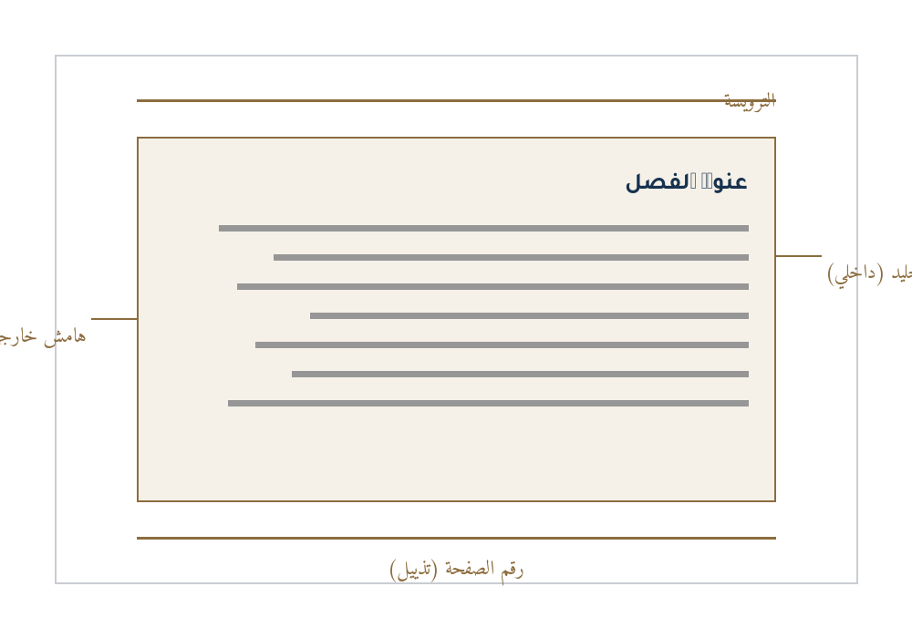

# نموذج أولي لتصميم الصفحات الداخلية

هذا فصل **تجريبي** الغرض منه معاينة نظام التصميم قبل اعتماده على الكتاب كله. يعرض النصّ التالي جميع العناصر التي سيتعامل معها التصميم: العناوين بثلاثة مستويات، والفقرات، والقوائم، والجداول، والأشكال، وصناديق الملاحظات، والاقتباسات. كل نصّ هنا عيّنة اختبار (*specimen*) وليس محتوىً نهائياً.

## أولاً: مستوى العنوان الثاني

تكتب الفقرة الافتتاحية عادةً بلا مسافة بادئة، ثم تتابع الفقرات بعدها بالتنسيق نفسه. يحرص التصميم على تباعد أسطر مريح للعين، وعلى عرض قياس متوازن لا يقلّ عن خمس وأربعين كلمة في السطر ولا يتجاوز خمساً وسبعين؛ فالسطر الطويل يُتعب القارئ، والقصير يُشتّت الانتباه.

من القواعد المهمة في تنسيق الكتاب العربي ألّا ينفصل العنوان عن أول فقرة تليه، وألّا يُترك سطر يتيم في أعلى الصفحة أو أسفلها. النظام هنا يضبط هذه القواعد تلقائياً في نسخة الـPDF، ويضبط ما يقابلها في ملف الوورد عبر خاصية «الإبقاء مع التالي».

### مستوى العنوان الثالث

تُستخدم القوائم عند تعديد عناصر متوازية، مثل خطوات منهجية أو شروط تحقق:

- اختيار قياس الصفحة المناسب لنوع الكتاب ومجاله.
- تحديد الخطّ وحجمه وتباعد الأسطر بما يلائم الجمهور المستهدف.
- ضبط الهوامش، مع مراعاة هامش التجليد الإضافي في الجهة الداخلية.
  - الهامش الداخلي أكبر من الخارجي لأن جزءاً من الصفحة يُستهلك في التجليد.
  - في الطباعة الرقمية قد يُكتفي بهامش متماثل إن لم يكن الكتاب مجلّداً.
- مراجعة الصفحات بصرياً قبل اعتماد النسخة النهائية للطباعة.

أمّا القوائم المرقّمة فتُستخدم عند ترتيب الخطوات ترتيباً زمنياً أو منطقياً:

1. استلام المحتوى المعتمد من المؤلف بصيغة قابلة للتحرير.
2. تنظيم المحتوى في شجرة فصول وعناوين واضحة.
3. بناء النموذج الأولي للتصميم واعتماده.
4. إنتاج النسختين: ملف وورد قابل للتحرير، وملف PDF مطابق للتصميم.
5. الفحص والمراجعة، ثم التسليم.

> ملاحظة تحريرية: كل معلومة ناقصة أو متعارضة تُعلَّم في المخطوطة بعلامة واضحة، ولا تُستكمل بالتخمين أو الإنشاء.

## ثانياً: الجداول والأشكال

تُعرض البيانات المعقّدة في جداول ذات رأس واضح وتعليق مُرقّم، ويُراعى فيها اتجاه القراءة من اليمين إلى اليسار، ومحاذاة الأعمدة بما يسهّل المقارنة.

| العنصر | القياس المعتمد | ملاحظات |
|---|---|---|
| قياس الصفحة | A5 | مناسب للكتب التعليمية خفيفة الحمل |
| هامش التجليد | 8 مم | يُضاف إلى الهامش الداخلي فقط |
| حجم المتن | 12.5 نقطة | مع تباعد أسطر 21 نقطة |
| تباعد الفقرات | 7.4 نقطة | بلا مسافة بادئة للسطر الأول |

: العناصر الأساسية لنظام التصميم وقياساتها المعتمدة

::: note ملاحظة فنية
في الكتب العربية تكون الصفحة الفردية (الوجه) على يسار الصفحة المزدوجة عند فتح الكتاب، ويكون هامش التجليد على يمينها؛ لذا تُعكس الهوامش تلقائياً بين الصفحات الفردية والزوجية.
:::

::: tip نصيحة عملية
راجع دائماً أول نسخة PDF على شاشة بحجم الكتاب الحقيقي، ثم اطبع صفحتين متقابلتين على ورقتين للتحقق من توازن الهوامش قبل طباعة النسخة الكاملة.
:::



## ثالثاً: الحالات الخاصة

قد يحتاج الكتاب إلى عرض نصوص برمجية أو معادلات أو نصوص أجنبية داخل المتن العربي. يُعالج النظام هذه الحالات بخطّ أحادي المسافة واتجاه من اليسار إلى اليمين، مع إطار خلفية خفيف يميّزها عن المتن.

```text
margin_inner  = margin_outer + gutter
text_width    = page_width - margin_outer - margin_inner
line_height   = font_size * 1.68
```

---

ينتهي هذا الفصل التجريبي عند هذا الحد، ويتلوه في الكتاب فصول المحتوى الفعلي بعد اعتماد التصميم والمخطوطة النهائية.
